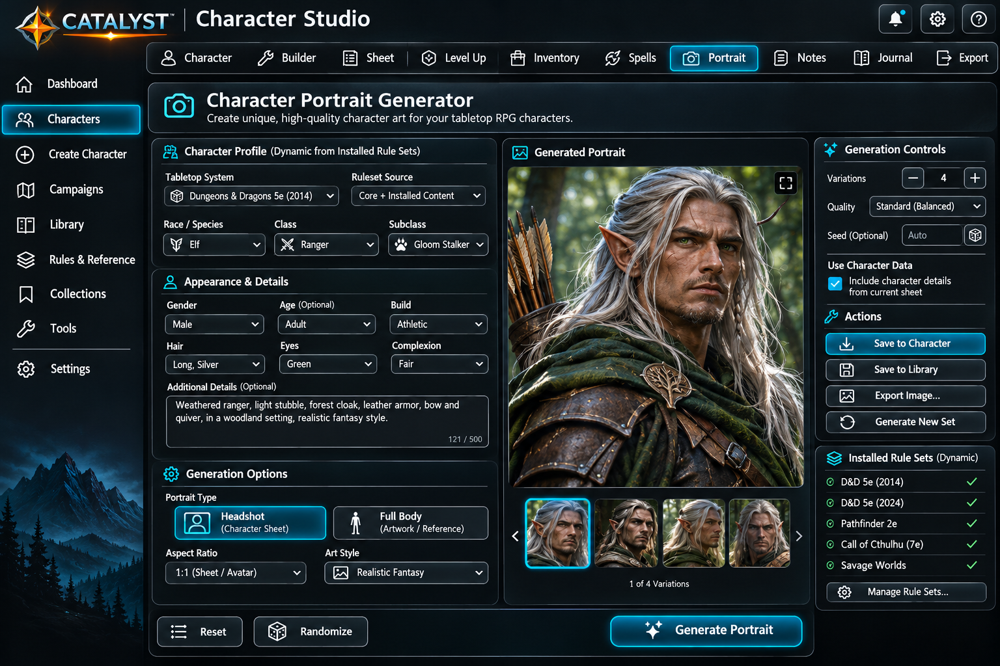

# 017 — Local Character Portrait Generation Engine (C13)

**Date:** 2026-11-23  
**Status:** Stable Diffusion 3 Medium pipeline approved as preferred model; optimization and hardware minimums require benchmarking. Not implemented.  
**Owner:** Shared Stable Diffusion inference runtime belongs to parent Catalyst; Character Studio owns the portrait-specific prompt/UI adapter. Standalone Studio may prototype against a shared runtime port, but must not fork the model service.  
**Consumers:** M01 Guided Builder, M02 Interactive Sheet, M04 NPC/Creature Composer; parent Catalyst may consume through a typed port.

## 1. Product requirement

Build a fully offline, optional **Character Portrait Generator**. Given a character's tabletop RPG system/edition, species/race/ancestry, class/role, background and optional appearance choices, generate an original portrait that can be selected for the canonical character sheet. Default D&D 5e (2014) experience is a UX preference, not a restriction: any supported system or System-Neutral character can generate or import a portrait. Generation must not be required to create, save, edit, print or advance a character.

**Approved model decision (2026-11-23):** Prefer **Stable Diffusion 3 Medium and its required complete pipeline**. The owner explicitly relaxed the previous 2B *total-pipeline* ceiling for SD3 Medium after hands-on portrait comparison found Sana 1.5 produced distorted faces. The 2B figure describes the SD3 Medium image backbone, **not** the total pipeline. Minimize actual disk footprint and peak RAM/VRAM through measured optimization (e.g. precision, quantization, optional component loading) without compromising portrait quality. Do not claim a guaranteed size, hardware minimum, license grant or CPU performance before verification. Keep weights optional and installed on demand.

## 2. User journey

1. Character builder/sheet offers **Portrait → Generate**, **Import**, **Choose Existing**, **Remove**.
2. **Dynamic installed-system selection:** tabletop system dropdown enumerates installed, validated rule-pack manifests from S04/C02, then a dependent edition/ruleset dropdown enumerates only installed compatible packs. Species/race/ancestry, class/role/profession, subclass/archetype/specialization and other descriptors are dynamically resolved from the selected pack's schemas and option catalogs; never hardcode D&D option lists. Changing system/edition invalidates incompatible selections with explicit notice, and reloading installed packs refreshes options. Empty/unavailable fields are hidden or disabled with explanation; classless systems show their actual field vocabulary. Existing character context is preselected and pinned to its pack version; portrait settings must not silently change character rules or edition. Prompt composer also offers editable age, hair, eyes, clothing/armor, equipment, expression, pose, background and visual style. Do not invent unsupported mechanics or lore as facts.
3. **Framing switch:** segmented **Headshot (Character Sheet)** / **Full Body (Artwork/Reference)**, default **Headshot** for new requests. Headshot prioritizes clear face and shoulders and sheet-friendly 1:1 crop; Full Body explicitly requests complete figure and a suitable taller aspect ratio. Both modes use the same installed SD3 Medium pipeline. User reviews prompt and starts generation. Show installed model, device mode, estimated resources if measured, progress/cancel and non-blocking failure recovery.
4. Preview generated result; **Use Portrait**, **Save to Library**, **Regenerate/Variation**, **Discard**. A generation never overwrites an existing portrait without confirmation.
5. Selected image is copied/linked through a host asset port with stable ID and metadata, then referenced by the character record via C01/C09. Preserve source image and crop metadata separately; sheet and print derive thumbnails.
6. Support **both headshot and full-body generation in the first portrait UI release**, with headshot as default and sheet attachment using a non-destructive crop. Consistent character variations are a future enhancement, not a V1 guarantee.

## 3. Engine boundaries and ownership

**C13 — Character Portrait Generation Adapter** owns character-specific prompt assembly, ruleset-aware selectors, headshot/full-body framing, portrait job UX, character attachment and portrait-specific diagnostics. **Parent shared image-generation service (new shared engine ID to be assigned in parent registry)** owns one SD3 Medium model installation, manifests, capability assessment, inference runtime, queue/job orchestration, seed/settings provenance, cancellation and generic output validation. Character Studio consumes it via a typed port, using a standalone host adapter during development. C13 does not own rules calculations, canonical character files, global asset storage, image editing UI, network access, PDF printing or sheet layout.

- **C01** owns character portrait reference and revision-safe updates; do not embed large image bytes in canonical JSON.
- **C09/M02** render and crop selected portrait without changing its source asset.
- **M01** supplies available character choices/appearance, without coupling wizard completion to generation.
- **M04** reuses C13 for NPC portraits, with no second model implementation.
- **S15** parent shared asset contract (or standalone adapter) stores and retrieves user-owned generated/imported files, with safe filenames and content hashing.
- **S14/C11** handle print/export, using selected asset with missing-image fallback.
- **S04** identifies game system/edition and supported descriptors; rules packs never execute model code.

Pure TypeScript C13 contracts and prompt orchestration must not import Tauri, Svelte, filesystem, network, or model runtime. The shared parent Windows inference service (possibly Rust process wrapper or isolated local worker) performs actual model execution and exposes a typed port. No cloud API or account dependency; model downloads, if supported, are explicitly user-initiated, verified, and never needed for normal app operation.

## 4. Proposed typed contracts (illustrative; refine during implementation)

- `PortraitCharacterContext { characterId, systemId, editionId?, species?, classOrRole?, background?, appearance?, style? }`
- `PortraitGenerationRequest { context, promptOverrides?, negativePrompt?, seed?, width, height, qualityPreset, modelId }`
- `PortraitModelManifest { id, version, license, componentFiles, sha256, totalParameters, diskBytes, minimumRamBytes?, minimumVramBytes?, supportedBackends, modelSource }`
- `PortraitJob { id, status: queued|running|completed|cancelled|failed, progress?, diagnostic?, outputAssetId? }`
- `PortraitInferencePort { listInstalledModels(), probeCapabilities(), generate(request, onProgress, cancellation), validateOutput() }`
- `PortraitAssetPort { importGeneratedImage(bytes, metadata), attachToCharacter(characterId, assetId, expectedRevision) }`

Keep generation and attachment as separate operations: cancelled or failed generation must never mutate a character. Persist optional seed/model/version/parameters/prompt metadata for reproducibility and user control, with an explicit option to exclude metadata on export.

## 5. Runtime, safety and licensing requirements

- **Offline by default and in operation:** no network calls, remote telemetry, model auto-downloads, accounts or API keys. Users opt in to obtaining/installing model weights; checksum verification and license acceptance are explicit.
- **Hardware:** target ordinary Windows PCs where practical; CPU fallback is desirable but not yet promised. Probe RAM/VRAM, CPU/GPU backend support and disk space; decline unsupported runs safely. Model installation is optional and removable.
- **Resource limits:** bounded image dimensions, generation concurrency default one, cancellation, memory/disk preflight, timeouts, temp cleanup and recovery after crash; generation runs off UI thread.
- **Content:** user-owned portraits only; no bundling copyrighted character art, protected franchise visual assets or unlicensed model weights. Review model licenses for commercial redistribution, derivatives, attribution, and offline distribution.
- **Security:** treat prompts and model packages as untrusted data; validated manifests and file paths; avoid arbitrary scripts from downloaded model bundles. Never pass private character notes into prompts without clear user control.
- **Privacy:** prompts, seeds, images and character metadata stay local. Provide delete and library management controls.
- **Accessibility:** keyboard-accessible controls, progress/status announcements, meaningful error states and text alternatives for selected portraits.

## 6. Candidate evaluation (research backlog, NOT selection)

**Primary:** Stable Diffusion 3 Medium (owner-approved model/pipeline; not yet approved for redistribution until license audit). Benchmark full pipeline disk/RAM/VRAM and optimize without degrading face quality. **Comparison history:** Sana 1.5 produced distorted faces in the owner's initial trial; keep as evaluation evidence, not the default. Verify SD3 license terms for intended commercial use/distribution, complete weights, Windows runtime, CPU/GPU compatibility, peak memory and performance. The previous 2B total-pipeline cap is superseded **only for this approved SD3 Medium pipeline**.

Benchmark a fixed prompt suite: elf ranger, human fighter, dwarf cleric, halfling rogue, a non-D&D investigator, a cyberpunk character and a System-Neutral homebrew archetype. Include multiple skin tones, ages, genders, attire and backgrounds. Score prompt adherence, anatomy, face quality, diversity, repeatability, time-to-image, peak RAM/VRAM, disk size and cancellation behavior. Record licenses and source revisions.

## 7. Build plan and acceptance gates

**C13-P0:** research/license/hardware spike; benchmark and license-audit the approved SD3 Medium full pipeline, record size/memory/performance and optimization tradeoffs; do not bundle weights until license and distribution rights are confirmed.

**C13-P1:** pure TS contracts, prompt builder and deterministic tests (no model dependency); System-Neutral and non-D&D tests required.

**C13-P2:** standalone local inference adapter with model manifest validation, Windows runtime capability probe, progress/cancel, disk/memory guardrails and offline smoke test.

**C13-P3:** S15 asset integration, portrait preview, Use Portrait/Discard, C01 revision-safe attachment, C09 rendering and C11 print/export fallback.

**C13-P4:** NPC integration, variations, portrait library management, performance tuning and parent Catalyst adapter.

**Definition of done:** with networking disabled, a supported Windows PC with an installed compliant model can generate a portrait, preview it, attach it to a character, save/reopen, print/export and remove it without corrupting the character; unsupported hardware and missing model produce actionable diagnostics; the SD3 Medium pipeline is optimized and measured against practical size/memory targets; licensing is documented; unit/integration/offline tests pass. No claim of completion before actual evidence.

## 8. Cross-reference

- `docs/architecture/016-CHARACTER-ENGINE-BUILD-PLAN.md` — C01–C12, M01–M04 and shared S15 ownership.
- `docs/design/CHARACTER-STUDIO-DASHBOARD-AND-WORKFLOW.md` — dashboard and creation UX.
- `AGENTS.md` — project-wide architecture, UI palette and agent constraints.
- Parent `Stormchyld2/Catalyst/docs/architecture/023-CATALYST-SHARED-AND-MODULE-ENGINES.md` — coordination source; parent document update is a separate task, not silently assumed complete.

## 9. Approved UI mockup implementation requirements (2026-11-23)

- Catalyst Obsidian/Charcoal/Gunmetal with Frost Blue controls; official logo assets only.
- Layout: character context and dynamically populated tabletop system → installed ruleset/edition → species → class/role → subclass/specialization, appearance details, Headshot/Full Body framing switch, aspect ratio/art style; center preview/variations; right generation controls, save actions, installed rule-pack summary.
- Ruleset dropdowns must read actual validated installed manifests/catalogs from the user's system files via existing S04/C02 interfaces and host adapters. Never present example systems in mockups as proof that those packs are installed.
- For a character already open, default selectors to the character's pinned system/edition and valid choices; edits in portrait composer affect prompts only unless user explicitly applies a character edit through C01.
- Class and subclass dependencies must refresh immediately; handle classless systems, empty catalogs, pack removal, and stale selections safely.
- Default **Headshot**; **Full Body** is a first-release option. Use separate prompts, framing and recommended aspect ratios; both remain editable.
- Generated image variants, Save to Character, Save to Library and Export Image are independent actions. No generation writes to canonical character data until user selects Save to Character.

## 10. Shared image generation and embedded navigation decision (2026-11-23)

- **Single global Stable Diffusion 3 Medium installation/runtime:** shared parent Catalyst service consumed by Character Studio, NPC tools, GM tools, and map-art workflows. Never duplicate model weights or implement separate image pipelines per module. Parent assigns a unique shared engine ID and updates its engine registry; this document does not claim parent files have been changed.
- **Map use is artwork only:** illustrated world/region maps, backgrounds, location concepts and textures are possible outputs. Coordinate-correct tactical grids, walls, scale, pathing, line-of-sight and editable vector/map layers remain owned by structured map engines, not SD3-generated pixels.
- **Standalone Studio navigation:** an expandable **Characters** parent item in the left pane, with nested child destinations (initial examples: Character Library, Create Character, Draft Characters, Import Character; final children remain subject to UX design). Active-character workspaces use top buttons/tabs: Character, Builder, Sheet, Level Up, Inventory, Spells, Portrait, Notes, Journal, Export; hide/disable system-inapplicable tabs. Avoid a second global Dashboard/Campaigns/Library/Settings rail.
- **Embedded in parent Catalyst:** parent owns the global left module navigation, dashboard, campaign, sourcebook library, settings and tools. Character Studio contributes an expandable **Characters** parent with nested Character Studio destinations in the existing left pane, plus contextual top workspace buttons/tabs. Do not duplicate global navigation. Host integration exposes typed routes, actions and state.
- **Standalone and embedded views:** same reusable workspace components, with host navigation adapter and optional standalone shell; no rewriting pages for integration.

## 11. Zero-reorganization integration requirement (2026-11-23)

Character Studio navigation is **module-owned, host-rendered**. Define one typed navigation manifest containing stable route IDs, parent/child relationships, labels, icons, ordering, visibility and feature requirements. The standalone shell and parent Catalyst shell both consume the same manifest; the parent determines the Characters group's global position. Do not hardcode sidebar markup or duplicate route definitions in feature pages. Character-specific top workspace tabs are a separate contextual manifest reused unchanged in standalone and embedded modes. Feature pages must be shell-agnostic and use injected navigation, settings, assets, storage, rules and image-generation ports; avoid absolute standalone-only paths. Integration should require adapter/registration wiring, not moving components or reorganizing directories. Verify this with a standalone-versus-embedded navigation contract test, route deep links, back navigation, and permission/feature gating. The exact final child list remains open.

## Approved portrait quality and generation controls (2026-11-24)

Extend the existing C13 adapter and shared SD3 Medium runtime, not a new engine. Implement in the existing P0–P4 sequence.

- **Structured prompt composition (P1):** deterministic assembly of validated pinned ruleset context, species, class/role, subclass, authored appearance, attire/equipment, pose/expression, framing, environment and lighting. Use class-aware visual descriptors, not invented mechanics; omit unknown fields and irrelevant details. Support classless and System-Neutral characters. Expose editable prompt preview; overrides affect artwork only.
- **Appearance and environment presets (P1):** data-only descriptive choices with stable identifiers; reuse the approved ruleset-aware environment catalog rather than duplicate it. Allow custom descriptions. Default to coherent cinematic realistic fantasy for fantasy systems, genre-appropriate style for other systems, and headshot framing. Full Body remains supported. Style presets guide composition, natural anatomy, facial detail, lighting and material texture without guaranteeing results.
- **Generation controls (P0/P2):** simple benchmarked quality presets plus optional advanced controls for supported dimensions/aspect ratio, inference steps, guidance scale and seed. Validate ranges against the installed backend and hardware limits; expose negative prompts or sampler choices only when actually supported. Do not invent defaults before benchmarking. Preserve cancellation and resource preflight.
- **Seed and provenance (P2/P3):** random seed by default, optional fixed seed, display/copy/reuse actual seed. Record resolved prompt, model/component versions, backend, dimensions, steps, guidance and other effective settings with output metadata through existing shared asset contracts. Repeatability is best-effort within matching runtime/hardware/settings, not guaranteed bit-identical across devices.
- **Optional refinement (P4):** investigate supported local image-to-image refinement or targeted correction for face/anatomy/composition and detail. Gate on actual SD3-compatible runtime capability, license, memory and measured quality. Preserve original image and create a separate preview variant; never overwrite the active portrait without explicit acceptance. No mandatory additional model or cloud service; regeneration remains fallback. Consistent identity across variants is not guaranteed.

**Verification:** P0 benchmark the existing fixed prompt suite across fantasy, modern and neutral contexts, headshot/full body, diverse appearances and environments. Compare face/anatomy quality, prompt adherence, composition, generation time, peak RAM/VRAM and repeatability. P1 test deterministic composition, missing descriptors, custom overrides and ruleset isolation. P2 test parameter bounds, seed handling, unsupported controls and offline cancellation. P3 verify metadata roundtrip and revision-safe attachment. P4 compare refinement with unrefined output and verify source preservation. Record actual results before selecting default quality settings or enabling refinement. Both standalone and embedded consumers use the same adapter/runtime and non-AI workflows remain available.
