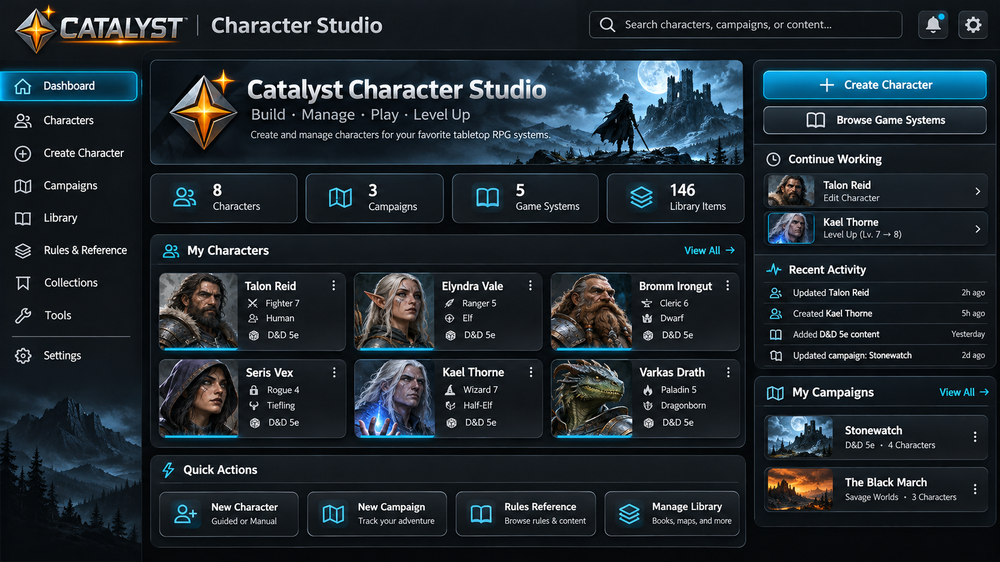

# Character Studio — Approved Dashboard and D&D Beyond–Familiar Workflow

**Date:** 2026-11-23  
**Status:** Dashboard concept approved as visual direction; this document specifies the intended navigation/workflow for implementation and further screen mockups. No functional UI is claimed to exist.  
**Parent reference:** `Stormchyld2/Catalyst` existing `src/lib/components/ModuleRail.svelte`, `SettingsDialog.svelte` and workspace conventions.  
**Brand assets:** `images/favicon.png` (official Catalyst symbol) and `images/logo (1).png` (official wordmark), committed to main. Do **not** draw a generic C, substitute a compass, recolor the logo, or use a generated logo. Frost Blue applies to the UI, not the artwork.

## Dashboard visual reference

> **Design reference only.** This is the approved layout concept, not an implemented application screenshot. The illustration predates receipt of the official Catalyst icon and therefore its generated compass logo must be replaced by the repository's actual `images/favicon.png` during implementation. The application must use the original icon, not the one depicted here.

## 1. Experience goal

Use D&D Beyond as a **familiar workflow reference**—character gallery → creation choices → guided stepper → sheet → advancement—without copying proprietary code, assets, text, branded controls, or exact trade dress. Catalyst owns its distinct appearance and multi-system, offline-first behavior.

## 2. Dashboard (approved baseline)

Preserve the reviewed dark dashboard composition: narrow Catalyst-style icon/label module rail on the far left, contextual Character Library pane beside it, and a large content canvas. Use Obsidian `#111214`, Charcoal `#202328`, Gunmetal `#2C3036`, Frost Blue `#6EA9CF`, Metallic Silver `#BCC2CC`, Primary `#F0F1F3`, Muted `#A3A9B2`, Borders `#41464E`, Hover `#8CC0E1`.

Dashboard sections:
- Header **Dashboard**, contextual description and primary **Create Character**.
- Summary counts **Characters**, **Drafts**, **Campaigns** (campaign count only when host data available; otherwise replace with relevant local metric, e.g. Favorites).
- **Continue where you left off**: most recently opened/edited characters with portrait, name, level/class when meaningful, system/edition, status, last saved time and Open Sheet. Never invent a level for System-Neutral.
- **Your Characters**: searchable, sortable grid/list; portrait, identity, system/edition, edited date, favorite, draft status, contextual actions.
- Draft recovery prompt only when drafts exist.
- **Empty state**: illustration/icon from bundled assets, short explanation, Create Character and Import Character; no fake demo characters unless explicitly in demo mode.
- Offline and save status reflect actual persistence state; never show “All changes saved” without confirmed save.

Library contextual pane: Search, All Characters, Favorites, Recent, Drafts, Collections, System/Edition, level range only for level-based systems, status, and New Collection. Keep filtering and searching synchronized with the content area; avoid duplicate independent search states.

## 3. Navigation and embedding contract

**Standalone navigation:** expandable **Characters** parent with child destinations (initial examples: Character Library, Create Character, Draft Characters, Import Character; final list subject to UX review). The active-character workspace uses top buttons for Character, Builder, Sheet, Level Up, Inventory, Spells, Portrait, Notes, Journal, Export; only show system-applicable features. Standalone and embedded shells consume the same module navigation manifest; do not duplicate the global parent rail. Collections and filters belong to library content rather than separate global navigation. Do not show campaign ownership where parent host is absent.

**Embedded in Catalyst:** parent owns the global module rail, window title/branding and settings host. Character Studio exports route descriptors, module entry point, contextual navigation, page components and settings-tab descriptors. **Do not nest a second global module rail or create a second settings dialog.** Host adapters inject project/campaign association, sourcebook access, dice, storage, permissions and print capabilities.

**Settings tabs** exposed by Character Studio: Character Defaults, Game Systems & Rules Packs, Character Storage & Backups, Character Sheet & Appearance, Import/Export & Printing, Accessibility (reuse parent controls when global). Standalone wraps these same tab components in its own settings shell; embedded renders them in parent Catalyst Settings.

Navigation away from unsaved work must respect save/revision guards and never silently drop changes.

## 4. Creation workflow — familiar, but original

1. **Create Character:** choose System-Neutral or an installed rules system; D&D 5e 2014 is the default edition selection when available; D&D 2024 selectable. Distinguish missing packs and availability.
2. **Method:** Guided Builder or Manual Sheet. Both generate the same C01 record.
3. **Guided steps:** system/edition and character basics, species/ancestry, class/role, background, ability scores, skills/proficiencies, equipment, spells/features when relevant, identity/portrait, review. **Step definitions are supplied by each rules pack**, not hardcoded D&D-only logic.
4. **Layout:** persistent numbered step navigation, central choice cards/forms, right live character summary with completion/validation and Save Draft; responsive collapse on smaller screens.
5. **Controls:** Back, Continue, Save Draft, Review and Finish; explicit prerequisites, blocked/optional states, change impact previews; do not finalize silently.
6. **Manual:** open editable sheet with system-aware fields and no artificial guided completion requirements.
7. **Review:** inspect selected choices, derived values, warnings, source provenance, system/edition/pack versions; finalize idempotently, then Open Sheet.

## 5. Interactive character sheet

Top identity/portrait strip with name, system, class/level where supported, edit/level-up actions and save state. Familiar primary sections—Overview, Abilities & Skills, Actions, Features, Inventory, Spells/Powers, Notes—appear only if supported by current system/template. Resources, conditions, equipment effects and rolls use their respective C engines and parent S07 dice port. Support read-only, unavailable pack and unsaved states.

**Advancement:** choose level/track → show gained choices and prerequisite impacts → before/after preview → validate → confirm → update sheet/history. No automatic level change without confirmation.

## 6. Character cards and contextual actions

Open Sheet, Edit, Duplicate, Favorite/Unfavorite, Move to Collection, Export/Print, Archive and Delete (with explicit confirmation). Mark missing rules packs and broken portrait references non-destructively. Support keyboard navigation, grid/list toggle, sorting and accessible text labels.

## 7. Visual and legal guardrails

- Use **actual official Catalyst images**, not AI-created approximations. Preserve original metallic/gold artwork even though the application chrome uses Frost Blue.
- No proprietary D&D Beyond assets, copy, screenshots or CSS copied into shipping product. Similar high-level user journey is acceptable; implementation and layout must remain original.
- All mockup characters and numbers are illustrative, not seeded real user data.
- Keep core operations offline. No network-dependent image, font, icon, or library service.
- WCAG 2.2 AA target, keyboard access, contrast verification, responsive split-pane, reduced motion.

## 8. Next screen design order and acceptance

1. Dashboard final with correct Catalyst icon and wordmark.
2. Create Character: system/method selection.
3. Guided Builder: stepper with live summary.
4. Interactive Sheet: overview and tab pattern.
5. Level Up: proposal and before/after preview.
6. Settings: standalone and embedded tab layouts.

**Approval boundary:** User approved the dashboard's overall visual direction and asked for D&D Beyond–familiar workflow. Detailed page interactions and subsequent mockups remain subject to review before coding. M0 implementation gates remain unfulfilled until actual workspace/build/test evidence exists.

## 9. Approved Character Library and card-opening workflow (2026-11-23)

**Status:** Layout direction and card behavior approved by product owner; illustrative mockup is not implemented code.

**Character Library layout:** expandable Characters sidebar group; prominent Create Character; search, grid/list toggle, sorting, system/edition/status filters, dynamic species/class filters from installed rule packs, and optional tags/collections. Main content uses character portrait cards with name, RPG system/edition, class/subclass and level **only where defined by that system**, status and favorite indicator. Selected-character preview may show a larger portrait, relevant identity, roster/campaign when available, and quick actions. No hardcoded D&D class/level assumptions for other RPGs. Empty/draft/archived/missing-pack states must be handled without fabricated user data.

**Card navigation contract (approved):**
- Clicking/tapping the **character card** opens that character's **Character Dashboard** (top workspace **Character** button), **not** the full sheet.
- Explicit **Open Sheet** on the card or preview opens that character's **Interactive Character Sheet** directly (top **Sheet** button), bypassing the dashboard.
- The **Character** top button always returns to the current character's dashboard; **Builder**, **Sheet**, **Level Up**, **Inventory**, **Spells**, **Portrait**, **Notes**, **Journal**, and **Export** navigate within the selected character's workspace as applicable.
- When no character is selected, contextual workspace buttons are hidden or disabled; library actions remain available. Preserve current character ID, deep-link routing, browser-like back navigation, unsaved-work guards and role/permission checks.

**Character Dashboard (next mockup):** character portrait, identity, RPG system/edition, class/subclass/level only if meaningful, campaign/roster status, system-defined key stats (e.g. D&D HP/AC/speed), progression, recent changes and quick actions for Open Sheet, Edit Build, Level Up, Inventory, Spells and Portrait. Use dynamic rule-pack view models, not a universal hardcoded D&D dashboard. Dashboard is a landing/overview page distinct from the full interactive sheet.

**Integration requirement:** one module-owned typed navigation manifest for Characters parent and children, one contextual top-button manifest, same reusable pages in standalone and embedded Catalyst. The parent shell chooses the Characters group's global placement; no moving files or rewriting screens at integration.

**Next design order:** Character Dashboard → Interactive Sheet → Create Character/Guided Builder → other contextual screens. Prior sequence in §8 is superseded for screen-design order only, not implementation gates.
