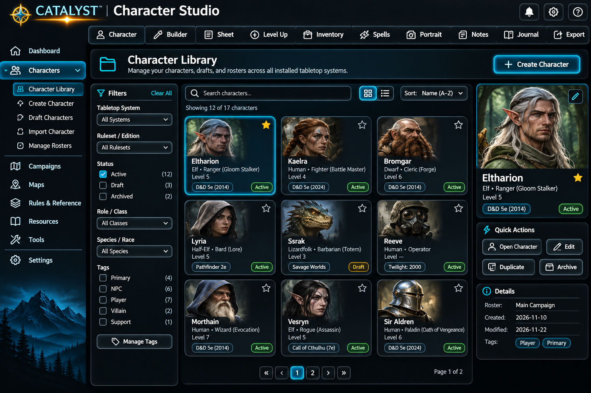
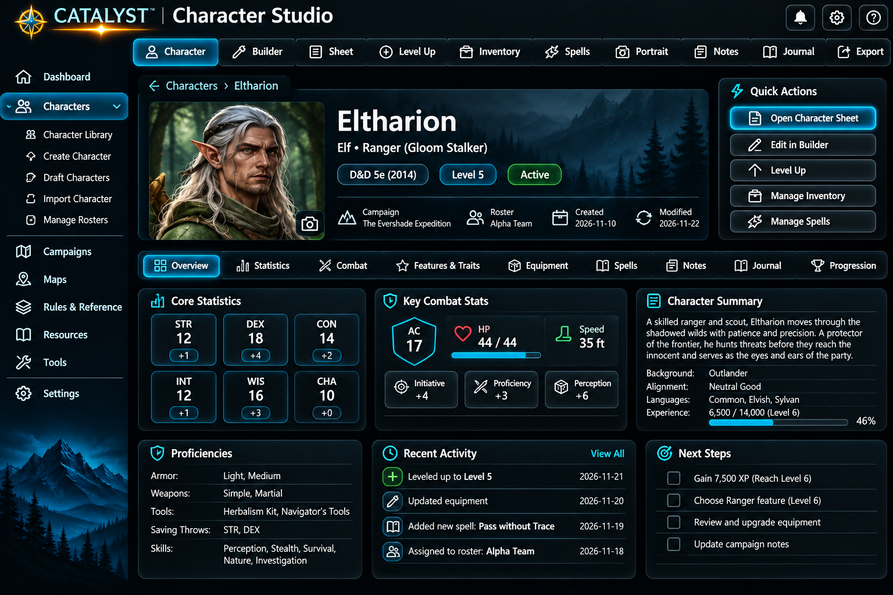
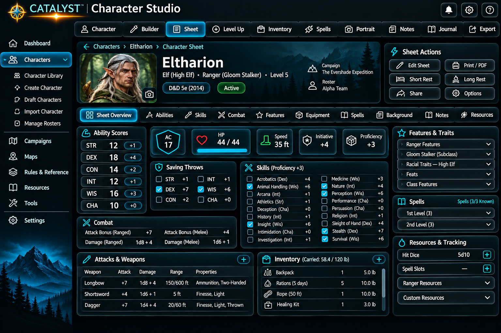
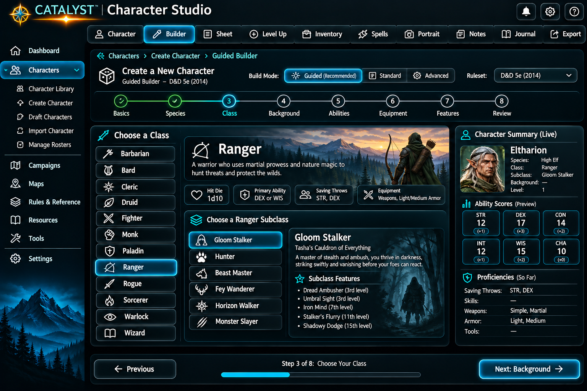
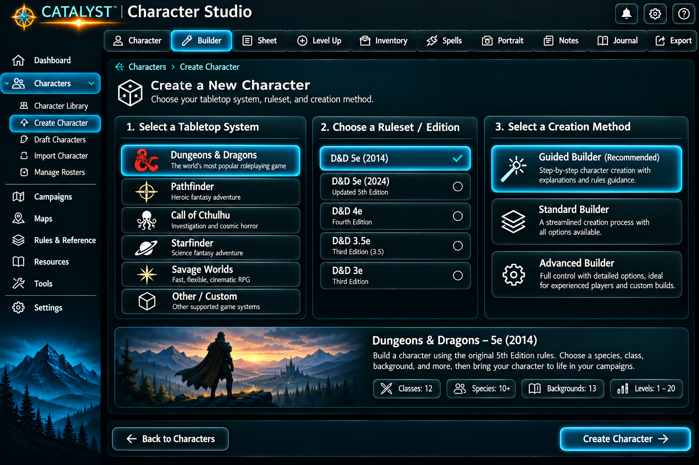
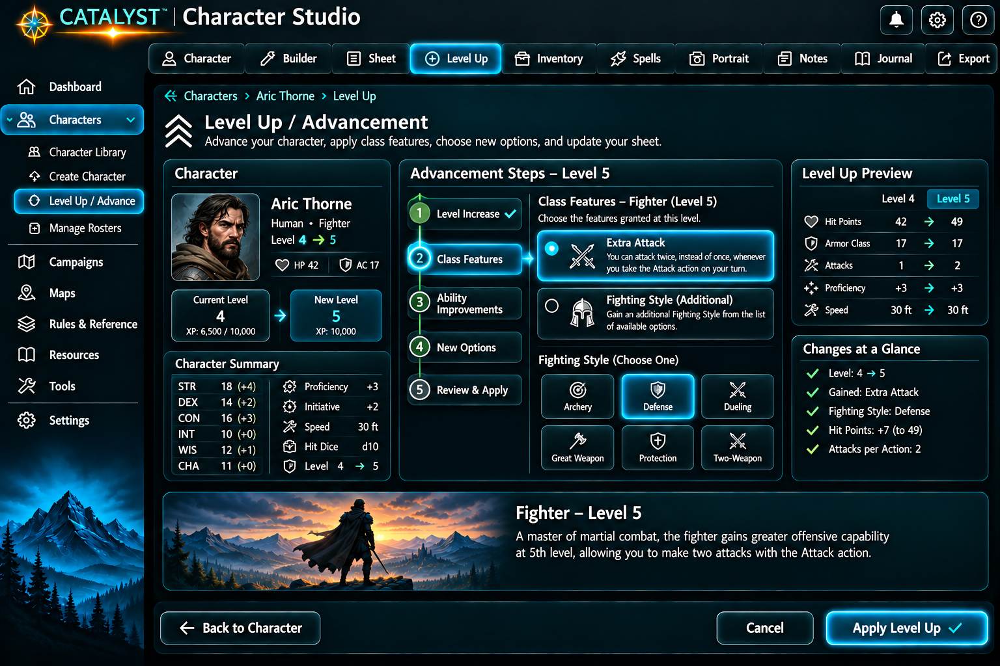
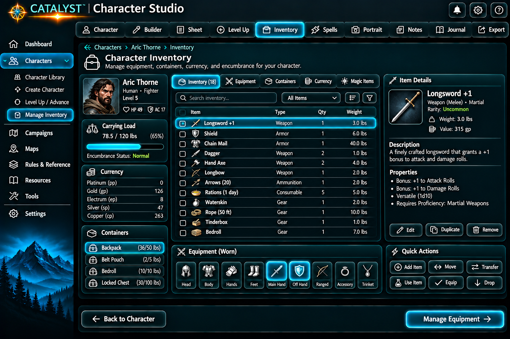
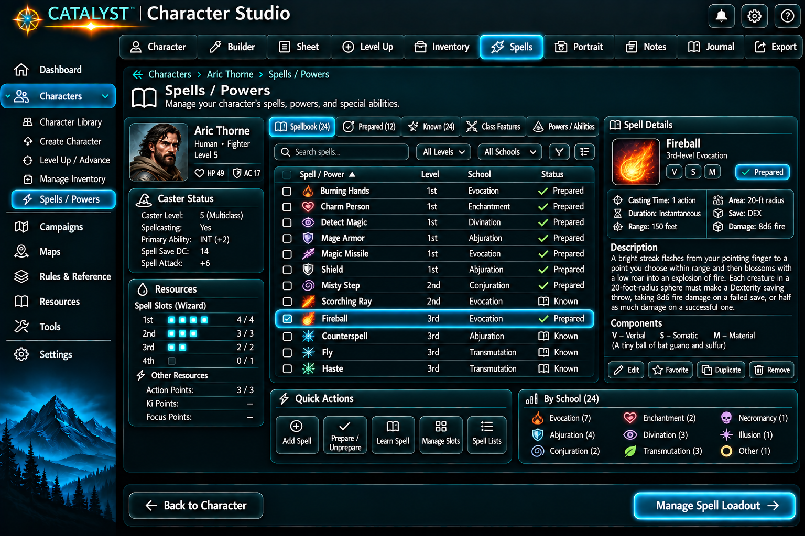
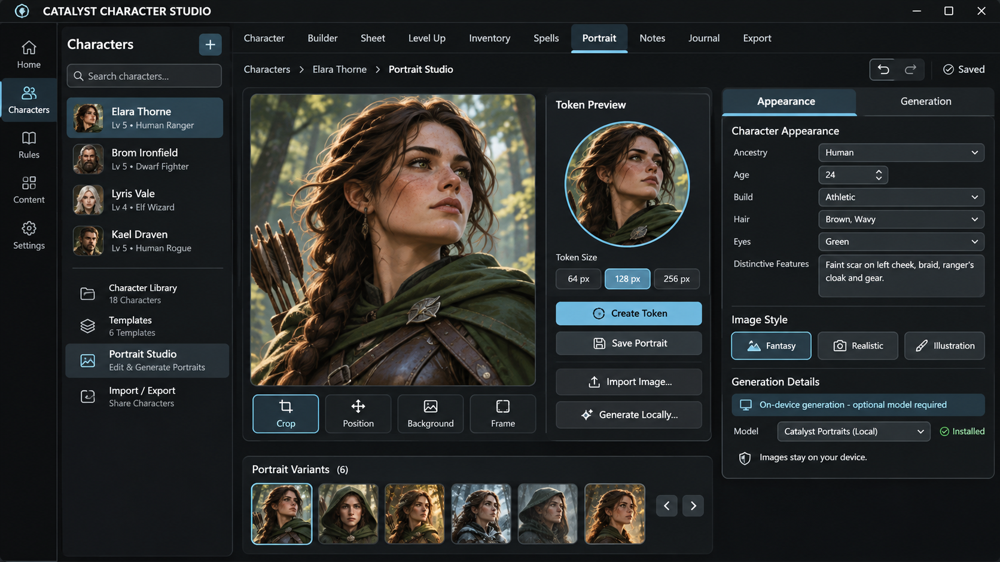
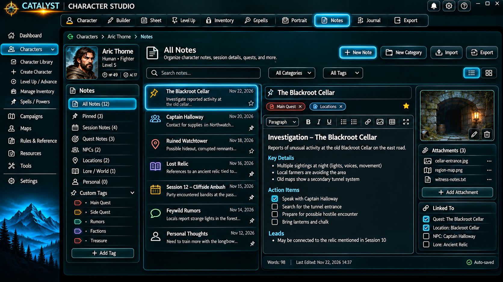

# Character Studio — Approved Dashboard and D&D Beyond–Familiar Workflow

**Date:** 2026-11-23  
**Status:** Dashboard concept approved as visual direction; this document specifies the intended navigation/workflow for implementation and further screen mockups. No functional UI is claimed to exist.  
**Parent reference:** `Stormchyld2/Catalyst` existing `src/lib/components/ModuleRail.svelte`, `SettingsDialog.svelte` and workspace conventions.  
**Brand assets:** `images/favicon.png` (official Catalyst symbol) and `images/logo (1).png` (official wordmark), committed to main. Do **not** draw a generic C, substitute a compass, recolor the logo, or use a generated logo. Frost Blue applies to the UI, not the artwork.

## Dashboard visual reference

> **Design reference only.** This is the approved layout concept, not an implemented application screenshot. The illustration predates receipt of the official Catalyst icon and therefore its generated compass logo must be replaced by the repository's actual `images/favicon.png` during implementation. The application must use the original icon, not the one depicted here.

## 1. Experience goal

Use D&D Beyond as a **familiar workflow reference**—character gallery → creation choices → guided stepper → sheet → advancement—without copying proprietary code, assets, text, branded controls, or exact trade dress. Catalyst owns its distinct appearance and multi-system, offline-first behavior.

## 2. Dashboard (approved baseline)

Preserve the reviewed dark dashboard composition: narrow Catalyst-style icon/label module rail on the far left, contextual Character Library pane beside it, and a large content canvas. Use Obsidian `#111214`, Charcoal `#202328`, Gunmetal `#2C3036`, Frost Blue `#6EA9CF`, Metallic Silver `#BCC2CC`, Primary `#F0F1F3`, Muted `#A3A9B2`, Borders `#41464E`, Hover `#8CC0E1`.

Dashboard sections:
- Header **Dashboard**, contextual description and primary **Create Character**.
- Summary counts **Characters**, **Drafts**, **Campaigns** (campaign count only when host data available; otherwise replace with relevant local metric, e.g. Favorites).
- **Continue where you left off**: most recently opened/edited characters with portrait, name, level/class when meaningful, system/edition, status, last saved time and Open Sheet. Never invent a level for System-Neutral.
- **Your Characters**: searchable, sortable grid/list; portrait, identity, system/edition, edited date, favorite, draft status, contextual actions.
- Draft recovery prompt only when drafts exist.
- **Empty state**: illustration/icon from bundled assets, short explanation, Create Character and Import Character; no fake demo characters unless explicitly in demo mode.
- Offline and save status reflect actual persistence state; never show “All changes saved” without confirmed save.

Library contextual pane: Search, All Characters, Favorites, Recent, Drafts, Collections, System/Edition, level range only for level-based systems, status, and New Collection. Keep filtering and searching synchronized with the content area; avoid duplicate independent search states.

## 3. Navigation and embedding contract

**Standalone navigation:** expandable **Characters** parent with child destinations (initial examples: Character Library, Create Character, Draft Characters, Import Character; final list subject to UX review). The active-character workspace uses top buttons for Character, Builder, Sheet, Level Up, Inventory, Spells, Portrait, Notes, Journal, Export; only show system-applicable features. Standalone and embedded shells consume the same module navigation manifest; do not duplicate the global parent rail. Collections and filters belong to library content rather than separate global navigation. Do not show campaign ownership where parent host is absent.

**Embedded in Catalyst:** parent owns the global module rail, window title/branding and settings host. Character Studio exports route descriptors, module entry point, contextual navigation, page components and settings-tab descriptors. **Do not nest a second global module rail or create a second settings dialog.** Host adapters inject project/campaign association, sourcebook access, dice, storage, permissions and print capabilities.

**Settings tabs** exposed by Character Studio: Character Defaults, Game Systems & Rules Packs, Character Storage & Backups, Character Sheet & Appearance, Import/Export & Printing, Accessibility (reuse parent controls when global). Standalone wraps these same tab components in its own settings shell; embedded renders them in parent Catalyst Settings.

Navigation away from unsaved work must respect save/revision guards and never silently drop changes.

## 4. Creation workflow — familiar, but original

1. **Create Character:** choose System-Neutral or an installed rules system; D&D 5e 2014 is the default edition selection when available; D&D 2024 selectable. Distinguish missing packs and availability.
2. **Method:** Guided Builder or Manual Sheet. Both generate the same C01 record.
3. **Guided steps:** system/edition and character basics, species/ancestry, class/role, background, ability scores, skills/proficiencies, equipment, spells/features when relevant, identity/portrait, review. **Step definitions are supplied by each rules pack**, not hardcoded D&D-only logic.
4. **Layout:** persistent numbered step navigation, central choice cards/forms, right live character summary with completion/validation and Save Draft; responsive collapse on smaller screens.
5. **Controls:** Back, Continue, Save Draft, Review and Finish; explicit prerequisites, blocked/optional states, change impact previews; do not finalize silently.
6. **Manual:** open editable sheet with system-aware fields and no artificial guided completion requirements.
7. **Review:** inspect selected choices, derived values, warnings, source provenance, system/edition/pack versions; finalize idempotently, then Open Sheet.

## 5. Interactive character sheet

Top identity/portrait strip with name, system, class/level where supported, edit/level-up actions and save state. Familiar primary sections—Overview, Abilities & Skills, Actions, Features, Inventory, Spells/Powers, Notes—appear only if supported by current system/template. Resources, conditions, equipment effects and rolls use their respective C engines and parent S07 dice port. Support read-only, unavailable pack and unsaved states.

**Advancement:** choose level/track → show gained choices and prerequisite impacts → before/after preview → validate → confirm → update sheet/history. No automatic level change without confirmation.

## 6. Character cards and contextual actions

Open Sheet, Edit, Duplicate, Favorite/Unfavorite, Move to Collection, Export/Print, Archive and Delete (with explicit confirmation). Mark missing rules packs and broken portrait references non-destructively. Support keyboard navigation, grid/list toggle, sorting and accessible text labels.

## 7. Visual and legal guardrails

- Use **actual official Catalyst images**, not AI-created approximations. Preserve original metallic/gold artwork even though the application chrome uses Frost Blue.
- No proprietary D&D Beyond assets, copy, screenshots or CSS copied into shipping product. Similar high-level user journey is acceptable; implementation and layout must remain original.
- All mockup characters and numbers are illustrative, not seeded real user data.
- Keep core operations offline. No network-dependent image, font, icon, or library service.
- WCAG 2.2 AA target, keyboard access, contrast verification, responsive split-pane, reduced motion.

## 8. Next screen design order and acceptance

1. Dashboard final with correct Catalyst icon and wordmark.
2. Create Character: system/method selection.
3. Guided Builder: stepper with live summary.
4. Interactive Sheet: overview and tab pattern.
5. Level Up: proposal and before/after preview.
6. Settings: standalone and embedded tab layouts.

**Approval boundary:** User approved the dashboard's overall visual direction and asked for D&D Beyond–familiar workflow. Detailed page interactions and subsequent mockups remain subject to review before coding. M0 implementation gates remain unfulfilled until actual workspace/build/test evidence exists.

## 9. Approved Character Library and card-opening workflow (2026-11-23)

**Status:** Layout direction and card behavior approved by product owner; illustrative mockup is not implemented code.

**Character Library layout:** expandable Characters sidebar group; prominent Create Character; search, grid/list toggle, sorting, system/edition/status filters, dynamic species/class filters from installed rule packs, and optional tags/collections. Main content uses character portrait cards with name, RPG system/edition, class/subclass and level **only where defined by that system**, status and favorite indicator. Selected-character preview may show a larger portrait, relevant identity, roster/campaign when available, and quick actions. No hardcoded D&D class/level assumptions for other RPGs. Empty/draft/archived/missing-pack states must be handled without fabricated user data.

**Card navigation contract (approved):**
- Clicking/tapping the **character card** opens that character's **Character Dashboard** (top workspace **Character** button), **not** the full sheet.
- Explicit **Open Sheet** on the card or preview opens that character's **Interactive Character Sheet** directly (top **Sheet** button), bypassing the dashboard.
- The **Character** top button always returns to the current character's dashboard; **Builder**, **Sheet**, **Level Up**, **Inventory**, **Spells**, **Portrait**, **Notes**, **Journal**, and **Export** navigate within the selected character's workspace as applicable.
- When no character is selected, contextual workspace buttons are hidden or disabled; library actions remain available. Preserve current character ID, deep-link routing, browser-like back navigation, unsaved-work guards and role/permission checks.

**Character Dashboard (approved mockup; see §10):** character portrait, identity, RPG system/edition, class/subclass/level only if meaningful, campaign/roster status, system-defined key stats (e.g. D&D HP/AC/speed), progression, recent changes and quick actions for Open Sheet, Edit Build, Level Up, Inventory, Spells and Portrait. Use dynamic rule-pack view models, not a universal hardcoded D&D dashboard. Dashboard is a landing/overview page distinct from the full interactive sheet.

**Integration requirement:** one module-owned typed navigation manifest for Characters parent and children, one contextual top-button manifest, same reusable pages in standalone and embedded Catalyst. The parent shell chooses the Characters group's global placement; no moving files or rewriting screens at integration.

**Next design order:** Character Dashboard → Interactive Sheet → Create Character/Guided Builder → other contextual screens. Prior sequence in §8 is superseded for screen-design order only, not implementation gates.

## 10. Approved Character Dashboard screen (2026-11-23)

**Status:** Character Dashboard visual direction approved by product owner. The mockup image should be committed as `images/character-dashboard-mockup.png` and referenced here once present; do not use a broken image link or assume the image was uploaded. Design approval does not mean the screen is implemented.

**Entry and navigation:** Clicking a character card opens this dashboard. Breadcrumb `Characters > [Character Name]` returns to Character Library. Top contextual tabs are Character (active), Builder, Sheet, Level Up, Inventory, Spells, Portrait, Notes, Journal, Export; omit or disable inapplicable tabs according to installed ruleset and character state. `Open Character Sheet` opens the interactive sheet; `Edit in Builder` opens the guided/manual builder without creating a new character. No selected character means no character dashboard.

**Approved layout:** retain Catalyst's expandable Characters sidebar and original branding; hero profile region with portrait, name, species/ancestry, class/role/subclass where supported, system and edition, level/progression when applicable, status, campaign/roster if available, and created/modified timestamps. Right quick-actions panel includes Open Character Sheet, Edit in Builder, Level Up, Manage Inventory, Manage Spells; show only permitted/applicable actions. Under the hero, a secondary overview navigation organizes Overview, Statistics, Combat, Features & Traits, Equipment, Spells, Notes, Journal, Progression according to system capabilities. Avoid confusing these in-page dashboard views with the global character workspace tabs; a secondary view stays within the dashboard unless intentionally routed to its dedicated module.

**Overview panels:** system-defined core statistics, combat summary (e.g., AC, HP, speed, initiative, proficiency/perception in D&D), character summary/background, proficiencies, recent activity/history, and next steps/progression. All values must come from the character record and installed rule pack; no hardcoded D&D fields in system-neutral or classless RPGs. Derived stats use shared formula/rules engines; experience thresholds, spell availability, armor and proficiency categories are ruleset-driven. Do not treat illustrative mockup values or example dates as test fixtures or authoritative game rules.

**Interaction and state:** show accurate autosave/persistence state; confirm destructive actions and guard unsaved edits; preserve keyboard accessibility and responsive stacking; allow navigation to full sheet and builder in one action. Activity entries reflect actual character history. Next-step items reflect actionable outstanding choices or progression, not fabricated tasks. Missing portrait/rules pack, draft, archived and read-only states render non-destructively. Keep UI offline-first.

**Branding and mockup limitations:** use actual `images/favicon.png` and `images/logo (1).png` in production, not generated substitutes. Frost Blue accents follow the approved palette. Character artwork and names in the mockup are placeholders. The screen is a character landing page, distinct from the full Interactive Character Sheet.

**Next screen for approval:** Interactive Character Sheet (approved; see §11).

## 11. Approved Interactive Character Sheet (2026-11-23)

**Status:** Product owner approved the visual layout. Save the mockup in repository root `images/interactive-character-sheet-mockup.png`; add an inline Markdown image reference here **only after** that image is committed. This is design approval, not proof of implementation.

**Purpose and routing:** The Sheet workspace button and the Character Library card's explicit Open Sheet action open this playable, editable sheet directly. The Character button returns to the selected character's dashboard. Maintain selected character, breadcrumbs (`Characters > [Name] > Character Sheet`), unsaved-work protection and back navigation. The top contextual workspace navigation remains Character, Builder, Sheet (active), Level Up, Inventory, Spells, Portrait, Notes, Journal, Export, filtered by ruleset/permissions.

**Approved screen composition:** Catalyst global sidebar with expandable Characters group; character identity header with portrait, name, ancestry/species, class/role/subclass, system/edition, status and campaign/roster when present. Sheet Actions panel: Edit Sheet, Print/PDF, Short Rest, Long Rest, Share and Options where applicable and supported. Under the header, sheet-local navigation: Sheet Overview, Abilities, Skills, Combat, Features, Equipment, Spells, Background, Notes, Resources; rules packs control the available tabs and labels. Use the approved Obsidian/Charcoal/Gunmetal and Frost Blue design system and original Catalyst logo assets.

**Sheet Overview panels:** ability scores and modifiers; combat headline stats (AC, current/max HP, speed, initiative, proficiency bonus where relevant); saving throws and skills with proficiency state; attacks/weapons and damage/range/properties; features and traits; spells/powers; inventory with quantities/weight where tracked; consumable resources such as hit dice, spell slots and class resources. Provide expandable detail and direct navigation to dedicated views without duplicating divergent state.

**Functional requirements:** This is an actual session-ready interactive sheet, **not** a static paper replica. Allow authorized editing and validated resource changes (damage/healing, current/max HP, temporary HP when supported, spell slot expenditure/recovery, hit dice, class/custom resources, equipment, currency and conditions). Dice-roll affordances use the host's shared dice service, with formula and rule-pack engines for modifiers. Track provenance and change history; never silently modify class/build choices or grant levels. Short/Long Rest actions must preview applicable ruleset-defined recovery and confirm before applying; hide them in systems without equivalent mechanics. Support keyboard, screen readers, responsive layout, and offline operation. Print/PDF and export use shared output services. Share is available only when a configured supported sharing mechanism exists, not as a dead button.

**Ruleset adaptability:** D&D 5e 2014 mockup values, names and example character are illustrative only; 2024 edition remains a distinct rules pack. Classless, non-level-based and non-D&D systems supply their own sheet sections, terminology, progression, resource semantics and actions through installed rule-pack definitions. No hardcoded D&D-only fields or spell-slot model in the universal schema or UI.

**State handling:** draft/incomplete characters, missing rules pack, broken portrait, archived/read-only, no spells, no inventory, invalid derived values and save failures must render intelligibly and non-destructively. Confirm destructive or irreversible actions. Save state must reflect actual local persistence.

**Next design screen:** Guided Builder (approved in §12), then Create Character entry screen.

## 12. Approved Guided Character Builder (2026-11-23)

**Status:** Product owner approved the Guided Builder mockup and confirmed the D&D Beyond–familiar stepwise creation approach. Visual/design approval only; no implementation is implied. Store the approved image at `images/guided-character-builder-mockup.png` and insert a relative Markdown image reference here after the image is actually committed.

**Screen structure:** Preserve the Catalyst global sidebar with expanded Characters group and contextual top workspace tabs, with Builder active. Breadcrumbs `Characters > Create Character > Guided Builder`; title, active tabletop system/edition selector and creation-mode control. The illustrated Guided / Standard / Advanced options are UX concepts: all must share the same character schema and validation, with mode-specific behavior specified before implementation; do not ship inert mode buttons.

**Progressive workflow:** Display a ruleset-driven, clearly labeled stepper with completed/current/upcoming states. The illustrated D&D 5e (2014) sequence is Basics → Species/Race → Class → Background → Abilities → Equipment → Features → Review, but exact ordering, terminology and steps come from the installed rules pack. D&D 5e 2014 and 2024 remain distinct editions. Non-D&D and classless systems must not inherit irrelevant D&D steps. Provide Previous, Next, Save Draft, Review/Finish and explicit validation feedback. Step changes must not discard work.

**Main choice area:** Searchable/browsable list of eligible options (illustrated with classes), a prominent selected-option description and mechanics summary, source attribution when licensed/available, and a conditional second-level choice area (illustrated with ranger subclasses). Class/subclass choices and availability must obey ruleset-specific level gates, prerequisites and dependencies; the mockup's level-1 subclass display is illustrative and must not override actual D&D rules. Locked options should explain requirements and distinguish missing content packs from failed prerequisites. Changes to earlier choices must show downstream impact before invalidating dependent choices.

**Live character summary:** Persistent responsive right pane with character name/portrait, system and edition, species/ancestry, class/role/subclass when applicable, background, current level/progression if supported, preview ability scores/modifiers and proficiencies. Update from validated character state and shared rules/formula services, not hardcoded example values. Show pending/incomplete choices without inventing defaults.

**Persistence and completion:** Save Draft at every stage, restore exact current step and selections, autosave only with truthful status, and guard navigation away from unsaved changes. Final Review must display all selections, derived statistics, source/pack provenance and warnings, require explicit confirmation, then create/finalize the character idempotently. From completion offer Character Dashboard and Open Sheet. Builder edits to existing characters use the same record with revision history, not duplicate characters.

**Visual and integration contract:** Use Obsidian/Charcoal/Gunmetal with Frost Blue accents, official Catalyst branding assets, accessible keyboard/focus controls, responsive collapse for the summary, and fully offline rules-pack data. One reusable builder route/component set serves both standalone Character Studio and embedded parent Catalyst. The mockup is a visual reference, not a source of licensed rule text or proof of actual rules compliance.

**Next screen for approval:** Create Character entry (tabletop system, ruleset/edition, and Guided versus Manual creation selection).

### 12.1 Mandatory dynamic ruleset-driven controls (approved clarification)

**No hardcoded character-creation dropdowns or option cards.** All system-dependent controls (including tabletop system, edition, ancestry/species/race, class/role, subclass/specialization, background, abilities, skills, proficiencies, feats, equipment, spells/powers and system-specific choices) must be generated from the selected installed ruleset/edition and its enabled content packs via the shared rules-pack registry and choice/prerequisite engine. The UI may render a field as a dropdown, searchable list, cards or a picker, but the options and their labels have the same authoritative source.

Changing the selected system/edition refreshes step definitions, field vocabulary, option sets, validation, calculated previews and dependent controls. Class selection filters subclasses and enforces level/prerequisite gates; ancestry/background and other choices expose their own dependent selections. Hide irrelevant fields for classless or non-level-based systems. Distinguish unavailable/missing content packs from locked choices and explain why an option is disabled. Never silently discard existing selections when switching rulesets: warn, preview incompatibilities and require explicit confirmation or create a separate draft as appropriate.

The renderer must accept ruleset-defined schemas and extensions without a new hardcoded form for each tabletop game. Persist stable option IDs, edition and pack versions with character data; recompute and validate through the shared engines. Support empty, loading, missing-pack and incompatible-choice states completely offline. The D&D options in the approved mockup are illustrative, not a fixed implementation list.

### 12.2 Approved dynamic selection panel layout and scrolling (2026-11-23)

**Status: approved by product owner.** Dynamic ruleset options must not cause the overall Guided Builder screen, surrounding columns, or panel boundaries to jump or resize. Within a bounded selection panel, render only actual options supplied by the installed ruleset/edition: no empty buttons, blank placeholder cards, reserved slots or irrelevant controls. Use a responsive, consistently sized card grid that naturally fills available rows; when fewer cards exist, leave ordinary unused panel background without artificial card slots. Locked choices may be shown only when meaningful, with a clear disabled state and explanation. Do not fabricate missing ruleset options.

When option cards exceed the panel's available height, **scroll inside that panel** while keeping its outer dimensions and adjacent character summary stable. Hide the visual scrollbar while retaining mouse-wheel, touchpad, touch swipe and accessible keyboard scrolling/focus. Do not remove scroll functionality, trap keyboard focus or prevent discovery of offscreen choices; focus movement must scroll the selected item into view. Support reduced motion. On smaller viewports, deliberate responsive stacking is allowed, but changing an option must not unexpectedly reflow the desktop workspace. Apply the same principles to species, class, subclass, background, equipment and other ruleset-generated choice panels.

## 13. Approved Create Character entry screen (2026-11-23)

**Status:** Product owner approved the Create Character entry screen and explicitly confirmed all selections are dynamic. This is a visual and functional design specification, not an implemented screen. Approved mockup filename: `images/create-character-entry-mockup.png`; insert its relative image link only after that file is committed.

**Layout:** Keep Catalyst's approved sidebar and Frost Blue visual system. Breadcrumb `Characters > Create Character`, title, three adjacent bounded selection panels (1. Tabletop System, 2. Ruleset / Edition, 3. Creation Method), selected-ruleset information banner, Back to Characters and Create Character actions. On narrower viewports panels may stack responsively. During initial creation, character-specific top workspace actions must not imply an existing selected character; hide/disable nonapplicable tabs rather than showing misleading active-character controls.

**Dynamic data contract:**
- Tabletop System options are generated from **installed, enabled and supported** system entries in the shared rules-pack registry; do not ship the pictured system list as fixed buttons.
- Ruleset / Edition options are filtered by the chosen system and its installed/available edition packs; refresh immediately when the system changes. Preserve a previous selection only when it remains valid.
- Creation Method options are filtered by **implemented application capabilities** and compatibility with the selected system/edition. Guided, Standard and Advanced are conceptual options, not a promise to enable an unimplemented mode. Each supported mode operates on the same character schema.
- Selected-ruleset banner title, description, artwork and statistics (such as number of classes, species, backgrounds or progression levels) derive from installed pack metadata and assets. Omit inapplicable metrics for classless/non-level systems; show fallbacks for absent optional artwork, never invent data.
- Create Character validates that all required selections are installed, compatible and usable, then launches the corresponding builder or manual sheet with exact system, edition and mode IDs. Missing packs and unsupported modes require clear actionable explanations, not dead buttons.

**Approved panel behavior:** Render only real options; no empty button slots or fabricated choices. Fixed desktop panel boundaries with consistent option card dimensions and natural packing; overflow scrolls **inside** the relevant panel with visually hidden scrollbar, preserving mouse-wheel, touchpad, touch and keyboard accessibility. Changes to selected options update dependent panels and banner without shifting the overall desktop layout. No unexpected scroll jump or loss of keyboard focus.

**Integration and reliability:** Shared typed navigation and ruleset registry work unchanged in standalone Character Studio and embedded Catalyst. Keep offline operation, preserve selected choices when valid, announce dependent-option resets when invalid, and support empty-library/missing-edition/loading/error states without implying a system is installed when it is not. All named systems and numerical counts in the mockup are illustrative.

**Next screen for design:** Determine the next unapproved character workspace screen (for example Level Up) before implementation.

## 14. Approved Level Up / Character Advancement screen (2026-11-23)

**Status:** Product owner approved the Level Up / Advancement visual layout. Mockup filename: `images/character-level-up-mockup.png`; add its relative Markdown image only once committed. Approval is of the visual concept and interaction model, not of the example Fighter mechanics or implementation.

**Layout and navigation:** Preserve Catalyst's expandable Characters sidebar, contextual workspace tabs with Level Up active, breadcrumb `Characters > [Character] > Level Up`, and Frost Blue styling. Three stable desktop regions: left current-character portrait/identity, current and proposed progression and baseline stats; center ruleset-driven advancement stepper and option selection; right before/after numeric preview and concise changes-at-a-glance. Below, an optional system-specific feature information banner and persistent Back to Character, Cancel and Apply Advancement controls. Responsive layouts may stack intentionally.

**Ruleset-driven advancement:** Load progression type, eligibility, steps, option definitions, prerequisite rules, granted features, calculations and validation from the character's installed system/edition/content packs. Level-based games show current/proposed levels; classless or skill-based games use their own progression terminology and mechanics. Only show relevant steps and actual choices, without blank cards or invented features. Automatic grants are not presented as optional picks. Missing packs, locked choices and unmet prerequisites must be explained clearly. Do not use the mockup's Fighter Level 4→5 feature or HP examples as authoritative rules data.

**Panel behavior:** Stable outer panel sizes, consistent option buttons/cards, internal mouse-wheel/touchpad/touch/keyboard scrolling with visually hidden scrollbars. Dependent selections update live without moving the surrounding workspace; selecting an option must not silently invalidate other choices. Keyboard focus and scroll position remain predictable.

**Preview and confirmation:** Compute an explicit before/after diff for changed attributes, resources, attacks, proficiencies, features and other system-specific values via shared rules/formula/choice engines. Display both automatic changes and selected options, plus any warnings or unresolved required choices. `Apply Level Up` is disabled until valid and complete, then requires explicit confirmation. Persist the advancement atomically to the existing character, log change history, and refresh the sheet/dashboard; prevent duplicate application on retries. Cancel leaves the character unchanged. Save draft/partial advancement safely when supported, without applying it prematurely.

**Availability and edge cases:** Respect character ownership/permissions, archived/read-only state, maximum progression, unsupported advancement, invalid/missing rule packs and offline storage failures. No false success messages; never apply partial changes. Use original Catalyst branding assets and the approved shared standalone/embedded navigation contract.

**Next screen to review:** Inventory or Spells workspace, depending on design priority.

## 15. Approved Character Inventory, Item Condition, and Currency Management (2026-11-23)

**Status:** Product owner approved the Inventory mockup **conditional on all capabilities in this section being implemented**. These are acceptance requirements, not optional future enhancements. Approved mockup filename: `images/character-inventory-mockup.png`; insert the relative Markdown image only once committed. The mockup is a visual reference, not a working screen.

**Layout:** Retain the approved Frost Blue Character Studio shell, contextual Inventory tab, character summary, carrying-load and currency panels, containers, searchable inventory grid, equipped-item slots, item detail inspector, and quick actions. Dynamic option sets show only real supported categories/actions/slots, with no empty cards. Bound panel dimensions; internal mouse-wheel, touchpad, touch and keyboard scrolling with visually hidden scrollbars. Responsive stacking is allowed on small screens.

**Complete item CRUD and use:** Add items from installed rules-pack catalogs or create fully custom items; inspect, edit, duplicate, equip/unequip, use/consume, change quantities, move between containers, transfer to another character or permitted destination, drop and remove items. Support notes, descriptions, type, rarity when defined, weight, value, ammunition, charges, stack sizes, container capacity and ownership/location. Validate inventory changes and avoid silent loss or duplication. Removing and destructive transfers require confirmation or a safe undo path.

**Two distinct damage concepts:** (1) weapon/attack damage statistics, including damage dice, type, modifiers, properties and special effects derived from applicable rules and item overrides; and (2) physical **item condition/damage**, including condition notes, wear, durability, damage incidents, repairs and broken state when supported. Never confuse damage dealt with item damage. Condition labels such as Pristine/Good/Worn/Damaged/Broken are configurable presentation defaults only; do not impose them as universal mechanics. Permit freeform condition notes even when the ruleset has no durability model.

**System-specific currency:** Denominations, names, symbols, exchange/conversion rules, precision and weight (if relevant) come from the installed system/edition/content packs; allow custom denominations where supported. Support adding/subtracting funds, purchases, loot/rewards, expenses, transfers between characters or containers and manual adjustments. D&D pp/gp/ep/sp/cp is only an example, not a universal model. Do not invent exchange rates for systems without them; allow systems with non-coin or no currency models.

**Audit/history:** Persist a local, timestamped history of acquisitions, edits, uses, condition changes, repairs, transfers, removals, purchases, rewards and currency changes with quantities/amounts and before/after values. Provide correction/reversal workflows without corrupting balances, inventory counts or provenance. A failed operation must not create a successful history entry.

**Shared state and calculations:** Inventory and currency are part of the authoritative character record and synchronized with the interactive sheet and dashboard. Equipping/unequipping, condition changes and encumbrance updates trigger ruleset-driven recalculation of relevant derived statistics; do not hardcode D&D weight limits, currencies, slots or equipment effects. Shared rules-pack registry, formulas, prerequisites and storage services are the sources of truth. Support classless systems, missing packs, custom items, offline operation, read-only states, and recoverable persistence failures.

**Acceptance gate:** Inventory design is not implementation-complete until adding, editing, deleting, condition/damage notation, system-specific currency transactions, equipment effects, transfers and history are functional and tested against at least a D&D rules pack and a materially different RPG currency/equipment model.

**Next screen:** Spells / Powers workspace.

## 16. Approved Spells / Powers Management (2026-11-23)

**Status:** Product owner approved the Spells / Powers visual layout and explicitly required spells and abilities to be sourced per selected tabletop system. Design approval does not imply implemented functionality. Save the approved mockup as `images/character-spells-powers-mockup.png`; add a Markdown image reference only once that asset is committed.

**Layout:** Preserve the Catalyst Frost Blue shell, expanded Characters navigation, contextual Spells tab and breadcrumb `Characters > [Character] > Spells / Powers`. Use stable desktop panels for character/caster summary and resource tracking (left), searchable/filterable spell or power catalog and loadouts (center), selected ability details (right), plus quick actions and system-specific summaries. Hide visual scrollbars but retain accessible mouse-wheel, touchpad, touch and keyboard scrolling inside overflowing panels. No empty cards or irrelevant fields.

**Authoritative source and edition isolation:** Read spell, power, ritual and special-ability definitions from the **character's selected tabletop system, edition, and installed/enabled content packs** through the shared rules-pack registry. D&D 5e (2014) and D&D 5e (2024) remain separate ruleset/edition contexts; Pathfinder, Call of Cthulhu, classless and custom systems expose their own mechanics and terminology. Never hardcode the example spell list, spell schools, slot levels, resource names or class rules into the generic UI. Display only authorized installed content; identify unavailable packs without pretending their spells are usable.

**Dynamic option states:** Distinguish catalog-available, eligible-to-learn, learned/known, prepared, equipped/assigned (if relevant), and currently castable/usable abilities. Filter by class, subclass, progression, traditions, prerequisites, access lists and other ruleset-specific constraints. Do not assume all systems have classes, preparation, spell slots or spell levels. Disabled/locked options must explain why; irrelevant actions and tabs disappear. Ruleset metadata determines which fields, filters and summary counts appear.

**Required operations:** Browse/search/filter and inspect; add/learn, prepare/unprepare, edit user-created abilities, duplicate custom entries, remove/unlearn when allowed, favorite, organize spell lists and loadouts, cast/activate, and track actual resource expenditure/recovery. Support user-defined spells/powers separately from immutable source-pack definitions; editing a catalog entry must create a character-owned override or custom copy rather than silently modifying shared source data. Show casting time, range, targets/area, duration, components, damage/effects, scaling, source and restrictions only when defined.

**Resource and sheet integration:** Resource models (slots, mana, power points, charges, uses/rest, rituals, focus, etc.) come from the installed ruleset. Before activation validate eligibility, current resources, applicable requirements and user confirmation where needed; apply resource consumption and effects atomically to the existing character, record history and update sheet/dashboard. Never consume resources on a failed action. Provide undo/correction where rules and history permit; do not invent automatic combat effects without an applicable rules engine.

**Acceptance requirements:** Demonstrate ruleset-specific catalogs and filters for at least two materially different supported systems, edition isolation, known/prepared/usable state distinctions, custom ability CRUD, resource tracking and synchronized character-sheet state. The mockup's Fighter and Fireball are illustrative and must not be treated as a valid default character build.

**Next screen for review:** Character Portrait or Notes / Journal workspace.

## 17. Approved Character Portrait Studio (2026-11-23)

**Status:** Product owner approved the complete Portrait Studio concept in the Catalyst project conversation. This section records the reviewed UI reference and interaction contract; it does **not** claim implementation. The supplied reference screenshot is `Catalyst Portrait Studio Interface(1).png` (not yet verified in this repository). Commit the screenshot to `images/character-portrait-studio-mockup.png` and add `` here **only after** that image exists in the repository. Keep this screen consistent with the dedicated portrait engine architecture in `docs/architecture/017-LOCAL-CHARACTER-PORTRAIT-GENERATION-ENGINE.md`.

### 17.1 Approved visual structure

Use the current Catalyst Character Studio shell and official Catalyst assets, not a newly generated logo. The screenshot shows a global icon rail, character picker/search sidebar with active character, top contextual tabs (Character, Builder, Sheet, Level Up, Inventory, Spells, **Portrait**, Notes, Journal, Export), breadcrumb `Characters > [Character] > Portrait Studio`, and save/undo/redo status.

The main work area has (1) a large editable character portrait preview with **Crop, Position, Background, Frame** tools, (2) an adjacent **Token Preview** panel with 64/128/256-pixel presets and **Create Token, Save Portrait, Import Image, Generate Locally** actions, (3) a right inspector with **Appearance** and **Generation** tabs, and (4) a bottom strip of selectable **Portrait Variants**. Preserve the approved dark charcoal, metallic surfaces and Frost Blue accent styling. Panel boundaries should remain stable, with internal scrolling and visually hidden scrollbars when content overflows; preserve keyboard/touch accessibility.

### 17.2 Portrait sources and editing

A character portrait may originate from an imported local image or from optional offline AI generation. Both sources open in the **same Portrait Studio editor** and support cropping, positioning, background adjustments and token frames. Preserve the original source asset; save non-destructive editing parameters and derived exports separately. Support multiple variants, switching between them, choosing the active portrait, saving to the selected character, saving to the shared portrait library, and exporting images. Show truthful unsaved/saved state and guard against losing changes. Missing image files must fail gracefully.

### 17.3 Dynamic appearance and generation controls

The Appearance tab includes ancestry/species (from the selected character's installed ruleset/edition), age, build, hair, eyes, distinctive features and image style, with additional appropriate fields supplied by the ruleset or portrait adapter. Ruleset-specific dropdown values must be generated from actual installed pack metadata, with no hardcoded universal ancestry list, empty buttons or irrelevant controls. User-entered descriptive appearance values remain available even if a ruleset lacks a formal vocabulary. Use validated character attributes to seed generation prompts without silently overwriting a player's chosen appearance.

The Generation tab exposes relevant on-device generation settings, model availability/install state and progress/errors. **Stable Diffusion 3 Medium** is the previously selected optional shared Catalyst image-generation pipeline, subject to hardware feasibility and licensing/distribution review; Character Studio uses its portrait adapter rather than installing or duplicating a separate model runtime. Generation must work fully offline once the optional engine and assets are installed. Do not falsely show `Installed` or `Saved` until verified. Support sheet-friendly **Headshot** (default) and **Full Body** outputs, selectable styles, variants, preview and explicit save/export. Import/edit/token workflows must remain available without the AI model.

### 17.4 VTT token creation and sharing

**Token Studio is an integrated tool within Portrait Studio**, not a separate character generator. Allow the user to create tokens from either imported or generated portraits. Provide live circular token preview, adjustable crop/position/zoom, frame/border/background treatment, and selectable export dimensions including **64, 128 and 256 px**. Keep original resolution where available; do not imply upscaling restores detail. Generate transparent PNG tokens where supported, and permit saved token variants. Associate the chosen token with the selected character for later use by the Catalyst VTT and character sheet. A phone/player companion or sharing server must receive only assets the user intentionally shares and for which access is authorized; no cloud service is required for local editing.

### 17.5 Integration, validation and acceptance

The character record links to its active portrait, selected token, image variants and non-destructive edit metadata using stable local asset references. Shared Catalyst asset/image services handle storage and exports; the Character Studio owns the portrait-specific UI and prompt adapter. The same components/routes must work in standalone Character Studio and embedded Catalyst without restructuring. Character selection switches the active portrait context safely. Respect read-only character states and offline-first persistence.

**Acceptance gate:** Verify import → edit → save portrait → reopen; local generation → edit → variant selection → save; token crop/frame → export at each supported size → assign to character → load in VTT; missing-model and missing-image states; ruleset-driven ancestry controls; undo/redo and unsaved-change guards. The reference screenshot is an approved **design mockup**, not evidence that any of these flows are coded.

**Next design screen:** Notes / Journal.

## 18. Approved Character Notes and Worldbuilding Wiki Integration (2026-11-23)

**Status:** Product owner approved the Character Notes screen and explicitly confirmed it is **player-owned note-taking, not direct editing of the Worldbuilding Wiki**. This is a design/architecture requirement, not proof of implementation. Approved visual mockup filename: `images/character-notes-mockup.png`; embed the relative Markdown image only after the asset is committed.

### 18.1 Notes screen and capabilities

Preserve the Catalyst Frost Blue shell, selected-character context, Notes workspace tab, character identity card, categorized/tagged note navigation, searchable and sortable note list, rich-text editor, attachment/linked-record inspector, and accurate local save state. Allow creation, editing, duplication, pinning, archiving, deletion with confirmation or recoverable undo, import and export. Support freeform categories, tags, checklists, images and file attachments, plus links to permitted NPC, quest, location, session, faction and lore records. Fixed-size desktop panels must scroll internally with visually hidden scrollbars while remaining keyboard/touch accessible; no empty placeholder buttons.

**Notes versus Journal:** Notes are freely organized personal information, theories, clues, reminders and observations. Journal is a separate chronological character adventure/session record. They may cross-link but are not interchangeable or duplicated data stores.

### 18.2 Ownership and Wiki boundaries

**Character Notes are owned by the character/player and are not canonical world lore.** The parent Catalyst Worldbuilding Wiki is the authoritative campaign knowledge base managed through its own permissions and editorial workflow. Editing, saving or deleting a character note **must never automatically create, edit or delete** a Wiki entry. A player's speculation must not become canonical campaign fact merely because it mentions an NPC, location or quest.

Store stable links to Wiki record IDs rather than copying entire Wiki articles into character notes. Link pickers and navigation must only expose records the current player is authorized to discover/read; GM-only secrets, unrevealed locations, hidden relationships and inaccessible attachments must remain inaccessible through search, previews, caches, exports and deep links. If a Wiki article changes, linked previews resolve to the latest authorized article while preserving the player's original note text. Broken, removed or newly restricted links fail gracefully.

**Optional proposal flow:** A player may explicitly submit a discovery or suggested Wiki correction for GM review, if the parent Catalyst supports this capability. This creates a separate pending proposal; it does **not** publish or mutate Wiki content until a suitably authorized GM approves it. Do not present this action as available until implemented.

### 18.3 Offline and integration contract

Notes and attachments persist locally, with truthful autosave, revision/recovery handling, unsaved-change guards, and no cloud dependency. Previously authorized Wiki material may be available offline only within the user's current authorization and caching policy; on reconnect, recheck permissions and reconcile changes without leaking GM-only content. Cross-device sharing/synchronization must be explicit and access-controlled; private notes remain private by default.

Character Studio owns the personal notes UI/data and references; the parent Catalyst owns the shared Wiki records, permissions, navigation targets and optional proposal-review workflow. Reuse typed integration contracts in standalone and embedded modes without duplicating the Wiki. In standalone mode, absent Wiki capabilities should be hidden or clearly unavailable rather than dead controls.

**Acceptance gate:** Verify private notes CRUD, tags/categories, checklist and attachments, reliable local save/recovery, permitted Wiki links, denied/hidden Wiki records, stale/broken links, no automatic Wiki edits, and correct standalone behavior. Any GM proposal flow requires separate authorization and approval tests.

**Next screen:** Character Journal.
